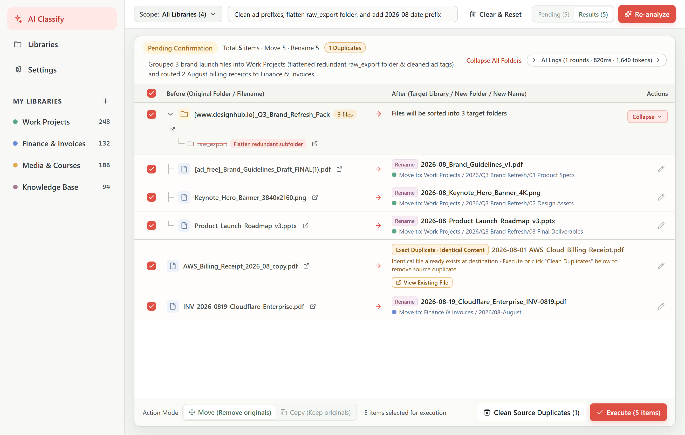
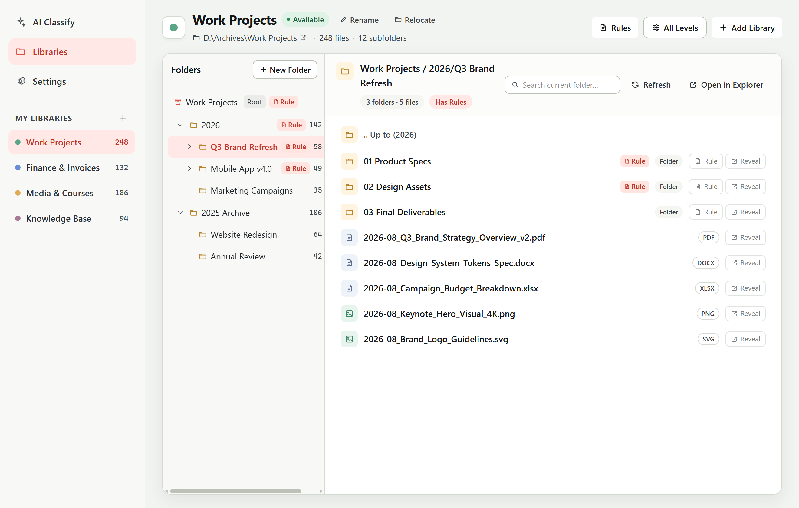
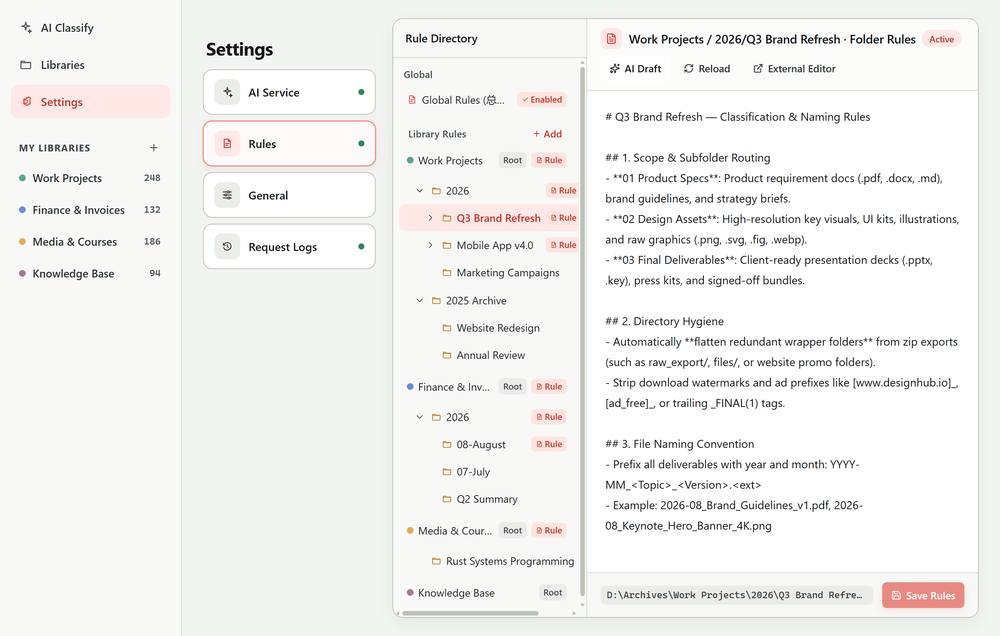
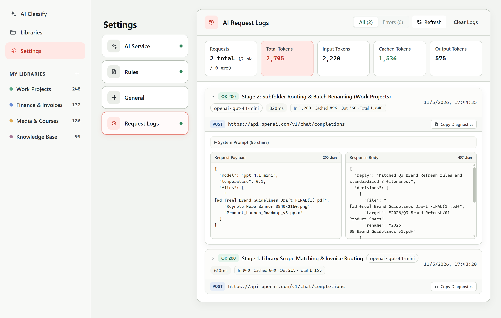

<div align="center">
  
  <h1>AIFileBox</h1>
  <p><strong>Local-first AI File Classification, Batch Renaming & Archiving Desktop Workbench</strong></p>
  <p>
    <a href="./README.md">English</a> ·
    <a href="./docs/README.zh-CN.md">简体中文</a> ·
    <a href="./docs/README.zh-TW.md">繁體中文</a> ·
    <a href="./docs/README.ja.md">日本語</a> ·
    <a href="./docs/README.ko.md">한국어</a> ·
    <a href="./docs/README.es.md">Español</a> ·
    <a href="./docs/README.fr.md">Français</a> ·
    <a href="./docs/README.de.md">Deutsch</a>
  </p>
  <p>
    <a href="https://github.com/qjr87/AIFileBox/releases/latest">
      
    </a>
    <a href="./LICENSE">
      
    </a>
    
    
  </p>
</div>

---

## 📸 Screenshots

### 1. AI Smart Classification & Batch Renaming (Before vs. After Review Plan)
Drag and drop loose files or entire download/project folders. AIFileBox automatically strips promotional prefixes, flattens redundant nested directories, and generates a side-by-side **Before vs. After Execution Plan** for manual review before touching any file:



### 2. Multi-Library & Folder Hierarchy Workbench
Register any local directory as a Library, browse folder trees and rule badges, and rename, adjust folder display depth, or relocate library paths anytime:



### 3. Hierarchical Markdown Rules & One-Click AI Rule Drafting
Combine **Global Rules** (`总说明.md`), **Library Root Rules** (`_规则.md`), and **Subfolder Rules**, or let AI draft rules automatically from your existing directory structure:



### 4. Multi-Provider AI & Request / Token Inspector
Native support for OpenAI-compatible APIs, Anthropic Claude, Google Gemini, and local Ollama (offline), complete with a built-in token usage, cache hit rate, and raw request/response diagnostic inspector:



---

## 📥 Download & Install (Windows / macOS)

Download the latest installers from [**GitHub Releases**](https://github.com/qjr87/AIFileBox/releases/latest):

| Platform | Architecture | Package Format | Notes |
| :--- | :--- | :--- | :--- |
| **Windows** | `x64` (64-bit) | `.exe` (NSIS) | Supports Windows 10 / 11; double-click to install |
| **macOS (Apple Silicon)** | `aarch64` (M1/M2/M3/M4) | `.dmg` / `.app.tar.gz` | For Apple Silicon Macs |
| **macOS (Intel)** | `x86_64` | `.dmg` / `.app.tar.gz` | For Intel-based Macs |

> **macOS First Launch Tip**: Since open-source builds are not notarized with a commercial Apple Developer certificate, if macOS Gatekeeper warns that the app is "damaged" or from an "unidentified developer" on first launch, run:
> ```bash
> sudo xattr -rd com.apple.quarantine "/Applications/AIFileBox.app"
> ```

---

## ✨ Key Features

- **🤖 AI Smart Classification & Batch Renaming**
  - Drag and drop loose files or entire project/media/download folders; recursively scans all nested files.
  - Automatically cleans ad prefixes, flattens redundant nested directories, and generates a clear **Review & Execution Plan** before touching any file.
  - Scope AI analysis to specific target libraries to save tokens and improve classification accuracy.
- **📚 Multi-Library Management & Hierarchical Markdown Rules**
  - Register any local folder as a Library; rename, adjust folder depth, or relocate library paths anytime within the app.
  - Supports **Global Rules** (`总说明.md`) + **Library Root Rules** (`_规则.md`) + **Subfolder Rules**, with one-click AI rule drafting based on existing directory structures.
- **🔌 Multi-Provider AI Support (Cloud + Local Offline)**
  - Native support for **OpenAI & OpenAI-compatible APIs** (DeepSeek, Qwen, SiliconFlow, OpenRouter, OneAPI, etc.), **Anthropic Claude**, **Google Gemini**, and local **Ollama** (works offline without an API key).
  - Built-in AI Request & Token Usage Inspector (input tokens, output tokens, cache hits, latency, and raw JSON payloads).
- **🛡️ Safety-First Local File Operations**
  - **Never silently overwrites**: Automatic conflict detection, SHA-256 sampled fingerprinting, and safe duplicate cleanup.
  - **Auditable & Reversible**: Every move/copy operation is logged in a local SQLite database with file signature verification and one-click undo.
  - **OS Keychain Protection**: API keys are stored in the native OS credential store (Windows Credential Manager / macOS Keychain) and never written to the repository.
- **🌍 8 Built-in Languages**
  - Built-in English, Simplified Chinese, Traditional Chinese, Japanese, Korean, Spanish, French, and German — switchable instantly in **Settings → General**.

---

## 🛠️ Tech Stack

- **Desktop Shell & Backend**: [Tauri 2](https://v2.tauri.app/) + Rust + SQLite (`rusqlite`) + OS Keyring (`keyring`)
- **Frontend UI**: React 19 + TypeScript + Tailwind CSS 4 + Vite

---

## 🚀 Local Development & Build

### Prerequisites

- **Node.js** >= 20
- **Rust** >= 1.80 (install via [rustup](https://rustup.rs/))
- Microsoft C++ Build Tools & WebView2 on Windows; Xcode Command Line Tools on macOS.

### Start Development Mode

```bash
# 1. Install frontend dependencies
npm install

# 2. Launch Tauri desktop development mode
npm run tauri -- dev
```

### Build Production Bundles

```bash
# Build frontend and verify TypeScript types
npm run build

# Verify Rust backend
cargo check --manifest-path src-tauri/Cargo.toml

# Package desktop installers (.exe on Windows, .dmg/.app on macOS)
npm run tauri -- build
```

---

## 🔒 Privacy & Security

- AIFileBox runs entirely locally on your machine. Aside from the AI model endpoint you explicitly configure, **no data is ever sent to any third-party server**.
- All local databases (`*.sqlite3`), environment files (`.env*`), and credentials are strictly ignored via `.gitignore`.

---

## 📄 License

Licensed under the [MIT License](./LICENSE).
